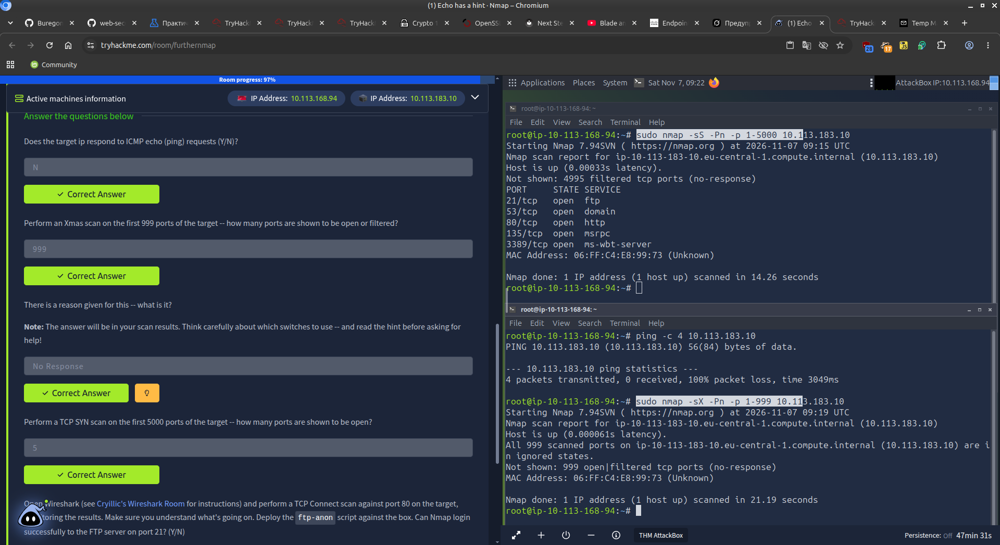

# Further Nmap — TryHackMe

**Room:** [Further Nmap](https://tryhackme.com/room/furthernmap)  
**Difficulty:** Easy  
**Platform:** TryHackMe 

---

## Описание

Практическая комната, посвящённая более глубокому использованию Nmap.  
Основные темы:

- Различные типы сканирования (SYN, Connect, Xmas, Null, FIN)
- Поведение файрволов и интерпретация состояний портов (`open`, `closed`, `filtered`, `open|filtered`)
- Работа с ICMP
- Использование NSE-скриптов

---

## Скриншоты

### Practice — результаты прохождения



---

## Целевая машина (на момент прохождения)

- IP: `10.113.183.10`

---

## Выполненные задания (Practice)

### 1. ICMP Echo Request

**Вопрос:** Does the target IP respond to ICMP echo (ping) requests? (Y/N)

**Ответ:** `N`

```bash
ping -c 4 10.113.183.10
```

Результат: `100% packet loss`

---

### 2. Xmas Scan (порты 1–999)

**Вопрос:** How many ports are shown to be open or filtered?

**Ответ:** `999`

```bash
sudo nmap -sX -Pn -p 1-999 10.113.183.10
```

Результат:
```
Not shown: 999 open|filtered tcp ports (no-response)
```

---

### 3. Причина результата Xmas-скана

**Вопрос:** There is a reason given for this — what is it?

**Ответ:** `No Response`

Nmap указывает причину как `no-response`.

---

### 4. TCP SYN Scan (порты 1–5000)

**Вопрос:** How many ports are shown to be open?

**Ответ:** `5`

```bash
sudo nmap -sS -Pn -p 1-5000 10.113.183.10
```

Открытые порты:

| Port  | State | Service       |
|-------|-------|---------------|
| 21    | open  | ftp           |
| 53    | open  | domain        |
| 80    | open  | http          |
| 135   | open  | msrpc         |
| 3389  | open  | ms-wbt-server |

---

### 5. NSE Script — ftp-anon

**Вопрос:** Can Nmap login successfully to the FTP server on port 21? (Y/N)

**Ответ:** `Y`

```bash
sudo nmap -sV -p 21 --script ftp-anon 10.113.183.10
```

Результат:
```
ftp-anon: Anonymous FTP login allowed (FTP code 230)
```

---

## Полезные команды

```bash
# Проверка доступности (ICMP)
ping -c 4 <IP>

# SYN-скан
sudo nmap -sS -Pn -p 1-5000 -T4 <IP>

# Xmas-скан
sudo nmap -sX -Pn -p 1-999 <IP>

# Null-скан
sudo nmap -sN -Pn <IP>

# FIN-скан
sudo nmap -sF -Pn <IP>

# NSE скрипт
sudo nmap -sV -p 21 --script ftp-anon <IP>
```

---

## Важные выводы

- Даже если хост не отвечает на ICMP, он может быть доступен (`-Pn` обязателен).
- Xmas / Null / FIN сканы часто показывают `open|filtered` при наличии фильтрующего файрвола.
- SYN-скан (`-sS`) — основной рабочий метод для поиска открытых портов.
- NSE-скрипты позволяют быстро получать дополнительную информацию (в данном случае — возможность анонимного входа на FTP).

---
