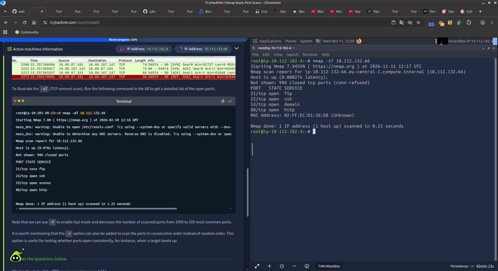
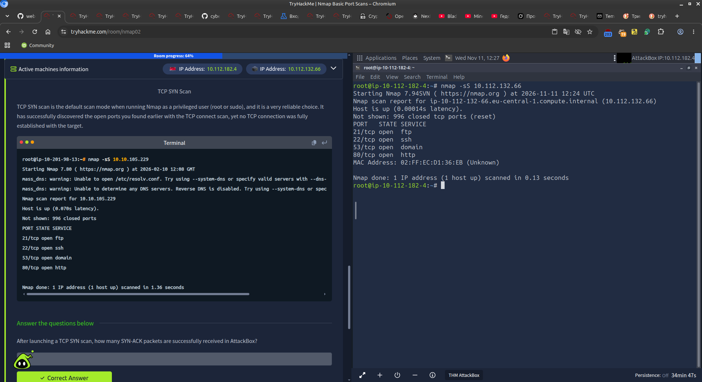
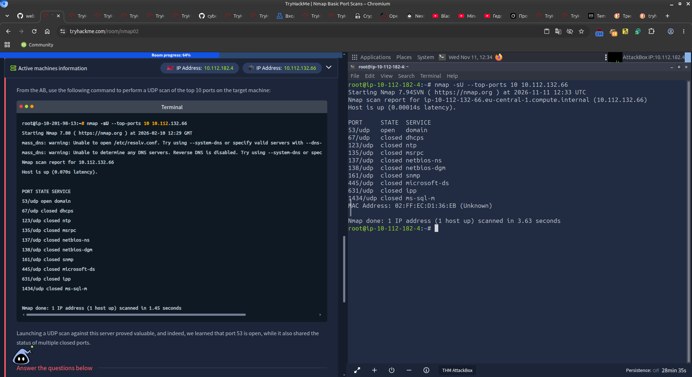

# Nmap Basic Port Scans - TryHackMe

**Room:** [Nmap Basic Port Scans](https://tryhackme.com/room/nmap02)  
**Difficulty:** Easy / Medium  
**Date completed:** November 2026  
**Platform:** TryHackMe AttackBox  
**Series:** 2/4 (Nmap series)

---

## Description

This is the second room in the Nmap series. Focus is on **basic port scanning techniques**:

- TCP Connect Scan (`-sT`)
- TCP SYN Scan (`-sS`)
- UDP Scan (`-sU`)

Also covers port states, TCP flags, and options for controlling scan scope and performance.

---

## Screenshots

### TCP Connect Scan


### TCP SYN Scan


### UDP Scan (top 10 ports)


---

## Room Structure

| Task | Title                              | Summary |
|------|------------------------------------|---------|
| 1    | Introduction                       | Overview of the room |
| 2    | TCP and UDP Ports                  | Port states and services |
| 3    | TCP Flags                          | URG, ACK, PSH, RST, SYN, FIN |
| 4    | TCP Connect Scan                   | `-sT` |
| 5    | TCP SYN Scan                       | `-sS` (half-open / stealth) |
| 6    | UDP Scan                           | `-sU` |
| 7    | Fine-Tuning Scope and Performance  | Port ranges, timing, speed |

---

## Key Answers

### Task 2 – TCP and UDP Ports

| Question | Answer |
|----------|--------|
| Which service uses UDP port 53 by default? | DNS |
| Which service uses TCP port 22 by default? | SSH |
| How many port states does Nmap consider? | 6 |
| Which port state is the most interesting to discover as a pentester? | Open |

### Task 3 – TCP Flags

| Question | Answer |
|----------|--------|
| What 3 letters represent the Reset flag? | RST |
| Which flag needs to be set when you initiate a TCP connection (first packet of TCP 3-way handshake)? | SYN |

### Task 4 – TCP Connect Scan

- Completes the full TCP 3-way handshake
- Works without root privileges
- Command: `nmap -sT <IP>`

### Task 5 – TCP SYN Scan

- Default for privileged users (root/sudo)
- Half-open / stealth scan (does not complete the handshake)
- Command: `sudo nmap -sS <IP>`

**Practice results (target `10.112.132.66`):**

| Port | State | Service |
|------|-------|---------|
| 21   | open  | ftp     |
| 22   | open  | ssh     |
| 53   | open  | domain  |
| 80   | open  | http    |

- After launching a TCP SYN scan, how many SYN-ACK packets are successfully received? → **4**

### Task 6 – UDP Scan

- Connectionless protocol
- Open ports often give no response
- Closed ports return ICMP Port Unreachable
- Command: `sudo nmap -sU --top-ports 10 <IP>`

**Practice results:**

| Port   | State  | Service |
|--------|--------|---------|
| 53/udp | open   | domain  |

---

## Useful Commands

```bash
# TCP Connect (no root required)
nmap -sT <IP>

# TCP SYN (requires root)
sudo nmap -sS <IP>

# UDP scan
sudo nmap -sU <IP>
sudo nmap -sU --top-ports 10 <IP>
sudo nmap -sU -F <IP>

# Port specification
nmap -p 22,80,443 <IP>
nmap -p 1-1024 <IP>
nmap -p- <IP>

# Fast mode (top 100 ports)
nmap -F <IP>

# Sequential port order
nmap -r <IP>

# Combined TCP + UDP
sudo nmap -sS -sU -F <IP>
```

---

## Key Takeaways

- `-sS` (SYN) is faster and stealthier than `-sT` (Connect)
- UDP scanning is significantly slower than TCP
- Port states: `open`, `closed`, `filtered`, `unfiltered`, `open|filtered`, `closed|filtered`
- For UDP, “silence” often means `open|filtered`
- `-F` greatly speeds up scans (top 100 most common ports)

---

## Related Rooms in the Series

1. [Nmap Live Host Discovery](https://tryhackme.com/room/nmap01)
2. **Nmap Basic Port Scans** ← current
3. [Nmap Advanced Port Scans](https://tryhackme.com/room/nmap03)
4. [Nmap Post Port Scans](https://tryhackme.com/room/nmap04)

---
