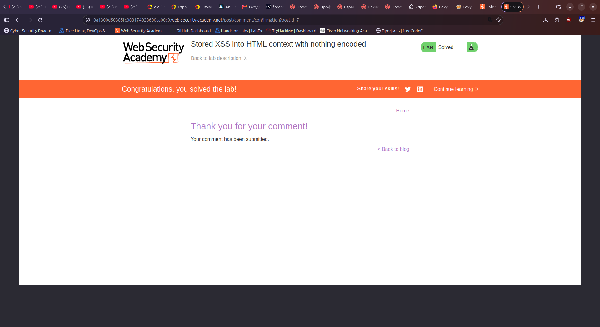
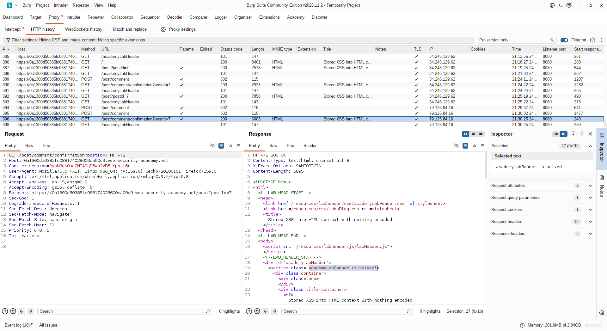

# XSS Lab: Stored XSS into HTML Context with Nothing Encoded

**Platform:** PortSwigger Web Security Academy  
**Difficulty:** Apprentice  
**Date Completed:** 24 November 2026  
**Status:** Solved

---

## Lab Description

This lab contains a stored cross-site scripting (XSS) vulnerability in the comment functionality.

The application stores a submitted comment and later displays it on the blog post page. The goal is to submit JavaScript that executes when the stored comment is viewed.

Because the input is inserted into an HTML context without encoding, an HTML `<script>` element can be interpreted by the browser.

---

## Tools Used

- Burp Suite Community Edition (Proxy → HTTP history)
- Firefox with FoxyProxy
- Browser Developer Tools (optional)

---

## Solution Steps

### 1. Open a Blog Post and Submit a Comment

1. Open the lab and navigate to a blog post.
2. Open the comment form.
3. Enter the required comment details.
4. Submit the comment while Burp Suite is capturing the traffic.

### 2. Inspect the Request in Burp Suite

1. Open **Proxy → HTTP history**.
2. Find the `POST /post/comment` request.
3. Inspect the request parameters/body to see the submitted comment.
4. The screenshot evidence shows the subsequent request to:

```http
GET /post/comment/confirmation?postId=7 HTTP/2
```

The confirmation page returned `HTTP/2 200 OK`.

### 3. Submit the XSS Payload

For this lab, the payload is:

```html
<script>alert(1)</script>
```

Place the payload in the comment field and submit the form. The payload is stored by the application and is interpreted as HTML/JavaScript when the comment is rendered.


### 4. Verify the Result

After submitting the comment, open the page where the comment is displayed. The browser executes the injected JavaScript.

The Burp response screenshot also shows the page containing:

```html
<section class="academyLabBanner is-solved">
```

This confirms that PortSwigger marked the lab as solved.

---

## Why the Payload Works

The application stores user-controlled comment content and later inserts it into an HTML page without appropriate output encoding.

The browser parses:

```html
<script>alert(1)</script>
```

as an HTML script element and executes its JavaScript.

This is **stored XSS** because the malicious input is persisted by the application and can execute when the stored content is viewed later. It is different from reflected XSS, where the input is returned in the immediate response to a request.

---

## Evidence

### Lab solved in the browser



### Comment submission and solved marker in Burp Suite



---

## Key Takeaways

- Stored XSS occurs when untrusted input is saved and later rendered in a page.
- HTML context without output encoding can allow injected markup and scripts to execute.
- Input validation alone is not a substitute for context-aware output encoding.
- Burp Suite HTTP history helps trace the comment submission and the server's response.
- The solved banner in the response is useful evidence, but browser-side execution is the behavior being tested.

---

## References

- [PortSwigger – Cross-site scripting](https://portswigger.net/web-security/cross-site-scripting)
- [PortSwigger – Stored XSS](https://portswigger.net/web-security/cross-site-scripting/stored)
- [Lab link](https://portswigger.net/web-security/cross-site-scripting/stored/lab-html-context-nothing-encoded)
