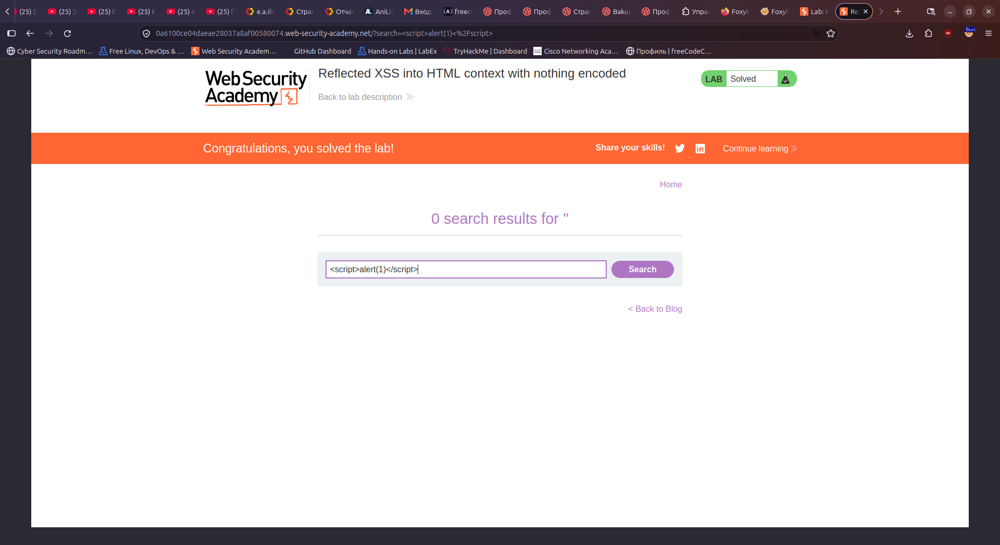
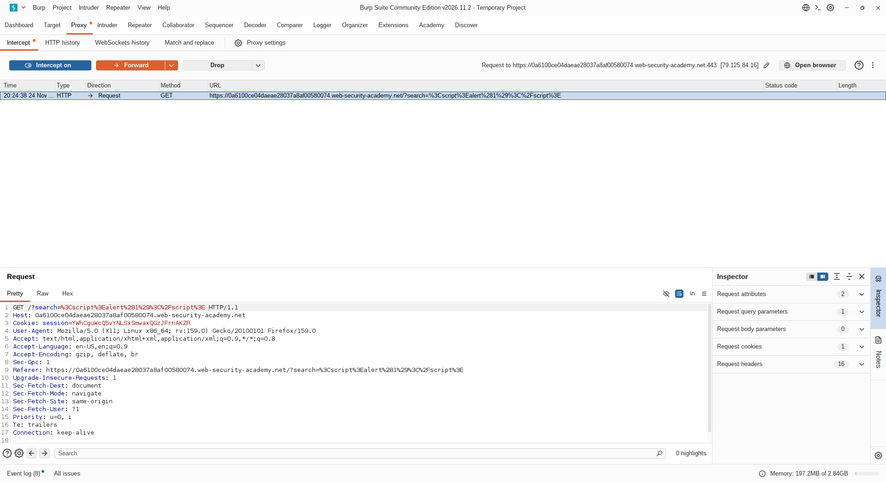

# XSS Lab: Reflected XSS into HTML Context with Nothing Encoded

**Platform:** PortSwigger Web Security Academy  
**Difficulty:** Apprentice  
**Date Completed:** 24 November 2026  
**Status:** Solved

---

## Lab Description

This lab contains a reflected cross-site scripting (XSS) vulnerability in the search functionality.

The application takes the search term from the request and reflects it into the HTML response without encoding. The goal is to make the browser execute JavaScript through the reflected input.

---

## Tools Used

- Burp Suite Community Edition (Proxy → Intercept / HTTP history)
- Firefox with FoxyProxy

---

## Solution Steps

### 1. Locate the Search Functionality

1. Open the lab.
2. Enter a normal search term and submit the search form.
3. Make sure the request is captured by Burp Suite.

### 2. Intercept the Search Request

In **Proxy → Intercept**, the captured request uses the `search` query parameter.

The request shown in Burp Suite is:

```http
GET /?search=%3Cscript%3Ealert%281%29%3C%2Fscript%3E HTTP/1.1
Host: <lab-id>.web-security-academy.net
```

The URL-encoded value corresponds to:

```html
<script>alert(1)</script>
```

### 3. Inject the Payload

Set the `search` parameter to:

```html
<script>alert(1)</script>
```

When URL-encoded in the request, the parameter appears as:

```text
%3Cscript%3Ealert%281%29%3C%2Fscript%3E
```

Forward the request in Burp Suite, or submit the same value through the browser's search form.

### 4. Verify the Result

The application reflects the search value into the HTML response without encoding. The browser interprets the injected `<script>` element and executes `alert(1)`.

The browser screenshot shows the lab page with the status **Solved** and the message:

```text
Congratulations, you solved the lab!
```

---

## Why the Payload Works

The application places the search parameter into an HTML context without encoding special characters.

The payload:

```html
<script>alert(1)</script>
```

contains an opening and closing `script` tag. Since the characters are not safely encoded before being inserted into the response, the browser treats the input as executable HTML/JavaScript instead of plain text.

This is **reflected XSS** because the injected input is returned in the response to the same request rather than being stored for later viewing.

---

## Evidence

### Successful result in the browser



### Search payload intercepted in Burp Suite



---

## Key Takeaways

- Reflected XSS occurs when user-controlled input is included in the immediate HTTP response.
- The context in which input is inserted determines the required encoding and defenses.
- URL encoding in the request does not make the value safe if the application decodes it and inserts it into HTML without output encoding.
- Burp Suite Intercept makes it possible to inspect and modify query parameters before forwarding a request.
- Context-aware output encoding and safe templating are important defenses against XSS.

---

## References

- [PortSwigger – Cross-site scripting](https://portswigger.net/web-security/cross-site-scripting)
- [PortSwigger – Reflected XSS](https://portswigger.net/web-security/cross-site-scripting/reflected)
- [Lab link](https://portswigger.net/web-security/cross-site-scripting/reflected/lab-html-context-nothing-encoded)
