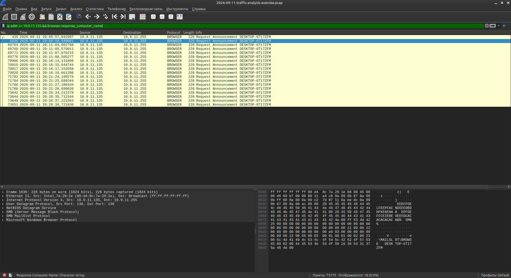
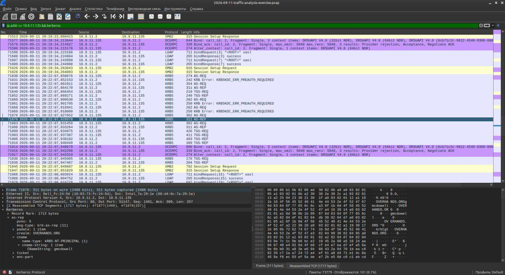
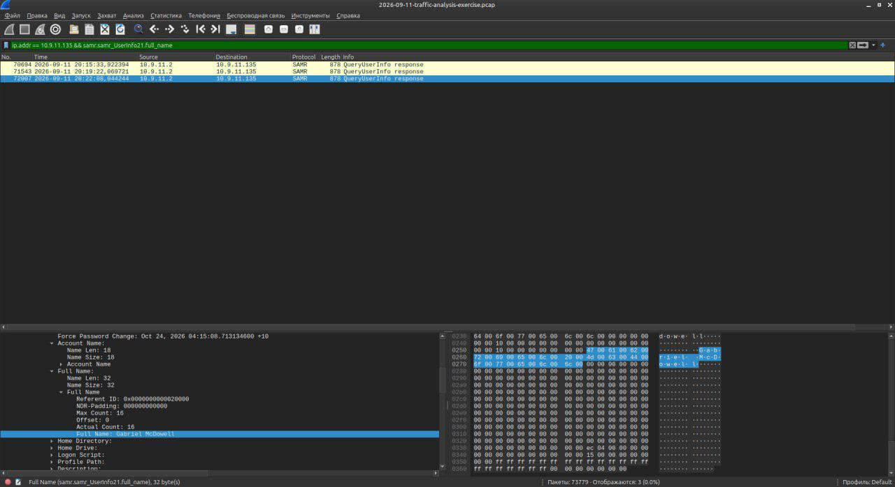
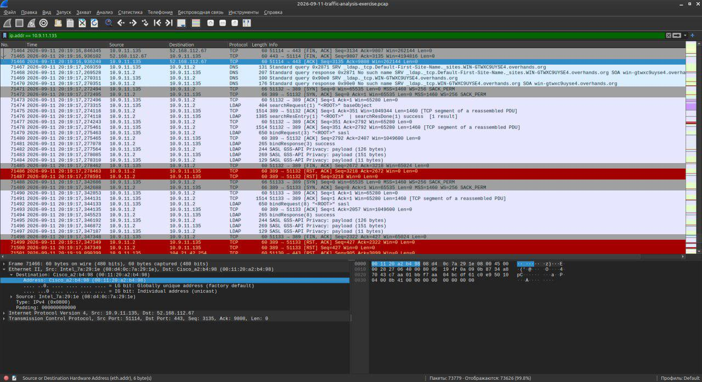

# Traffic Analysis Exercise: Kongtuke Rebuke! (2026-09-11)

**Source:** [malware-traffic-analysis.net](https://www.malware-traffic-analysis.net/2026/09/11/index.html)  
**Date completed:** November 2026  
**Tool:** Wireshark  
**Campaign:** Kongtuke ClickFix activity

---

## Description

Investigation of recent Kongtuke ClickFix activity on a domain-joined Windows host in an Active Directory environment.

The pcap contains traffic from the infected host. Additional files (HTTPS traffic, malware samples) are provided for deeper research, but only the pcap is required for this exercise.

### Environment

| Item | Value |
|------|-------|
| LAN segment | `10.9.11.0/24` |
| Domain | `overhands.org` |
| AD name | `OVERHANDS` |
| Domain Controller | `10.9.11.2` (WIN-GTWXC9UYSE4) |
| Gateway | `10.9.11.1` |

---

## Screenshots

### Endpoints (infected host is top talker)


### Host name (BROWSER / NetBIOS)


### User account (Kerberos)


### Full name (SAMR)


### MAC address


---

## Answers

| Question | Answer |
|----------|--------|
| What is the IP address of the infected Windows client? | **10.9.11.135** |
| What is the MAC address of the infected Windows client? | **00:d0:0c:7a:29:1e** |
| What is the host name of the infected Windows client? | **DESKTOP-6T17ZFM** |
| What is the user account name from the infected Windows client? | **gmcDowell** |
| What is the full name of the user from the user account? | **Gabriel McDowell** |

---

## Evidence

### 1. Infected client IP
- **IP:** `10.9.11.135`
- Confirmed via Statistics → Endpoints (IPv4) — highest traffic volume by far.
- Used in all subsequent filters.

### 2. MAC address
- **Source MAC:** `00:d0:0c:7a:29:1e` (Intel_7a:29:1e)
- Visible in Ethernet headers of frames originating from `10.9.11.135`.

### 3. Host name
- **Filter:** `ip.addr == 10.9.11.135 && browser.response_computer_name`
- **Protocol:** Microsoft Windows Browser Protocol (BROWSER)
- **Hostname:** `DESKTOP-6T17ZFM`

### 4. User account
- **Filter:** `ip.addr == 10.9.11.135 && kerberos`
- **Packet example:** ~71878 (AS-REP)
- **CNameString:** `gmcDowell`

### 5. Full name
- **Filter:** `ip.addr == 10.9.11.135 && samr.samr_UserInfo21.full_name`
- **Protocol:** SAMR (Security Account Manager Remote)
- **Full Name:** `Gabriel McDowell`

---

## Useful Wireshark Filters

```
ip.addr == 10.9.11.135
ip.addr == 10.9.11.135 && browser
ip.addr == 10.9.11.135 && kerberos
ip.addr == 10.9.11.135 && kerberos.CNameString
ip.addr == 10.9.11.135 && samr
ip.addr == 10.9.11.135 && samr.samr_UserInfo21.full_name
eth.src == 00:d0:0c:7a:29:1e
```

---

## Conclusion

**What happened?**  
A Windows host in the OVERHANDS domain was infected via Kongtuke ClickFix-style activity. The host generated significant traffic and authenticated with the domain controller using the account `gmcDowell`.

**Which host was affected?**  
- IP: `10.9.11.135`  
- Hostname: `DESKTOP-6T17ZFM`  
- MAC: `00:d0:0c:7a:29:1e`  
- User account: `gmcDowell`  
- Full name: `Gabriel McDowell`

**What evidence supports the identification?**  
- Endpoints statistics clearly identify `10.9.11.135` as the dominant internal host.  
- Browser Protocol announcements reveal the hostname `DESKTOP-6T17ZFM`.  
- Kerberos AS-REP contains the principal `gmcDowell`.  
- SAMR QueryUserInfo returns the full name `Gabriel McDowell`.  
- Ethernet source address consistently shows `00:d0:0c:7a:29:1e`.

**What should a SOC analyst investigate next?**  
- Review HTTPS traffic to the Kongtuke domain (bonus material available).  
- Examine the ClickFix script and any dropped payloads.  
- Check the infected host for persistence, running processes, and additional C2 connections.  
- Review authentication logs for the account `gmcDowell` and look for lateral movement within the OVERHANDS domain.

---
