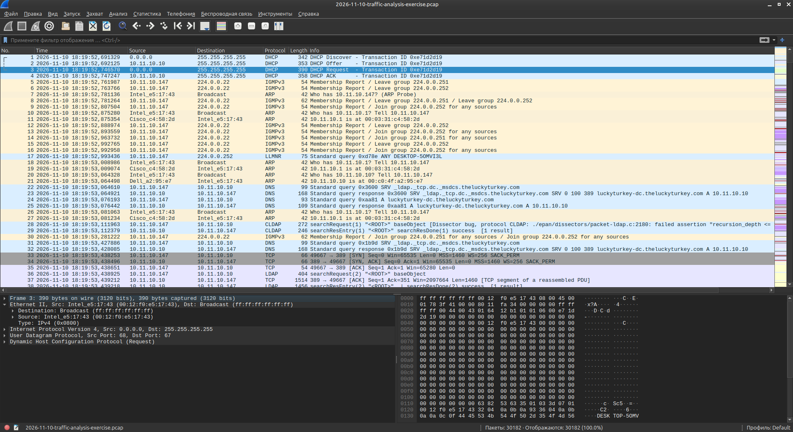
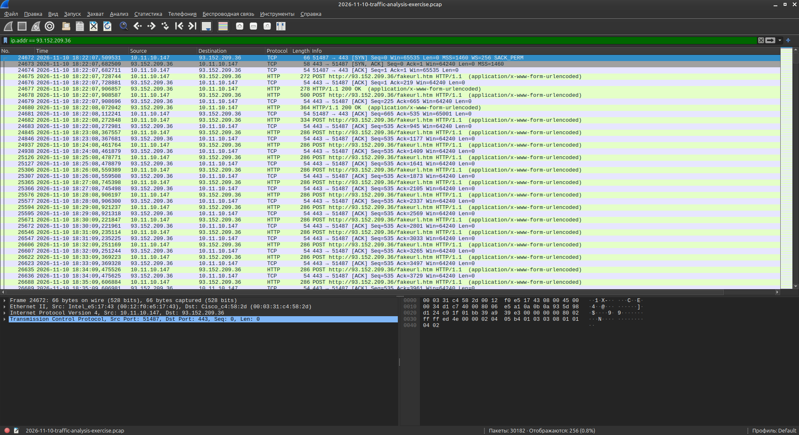
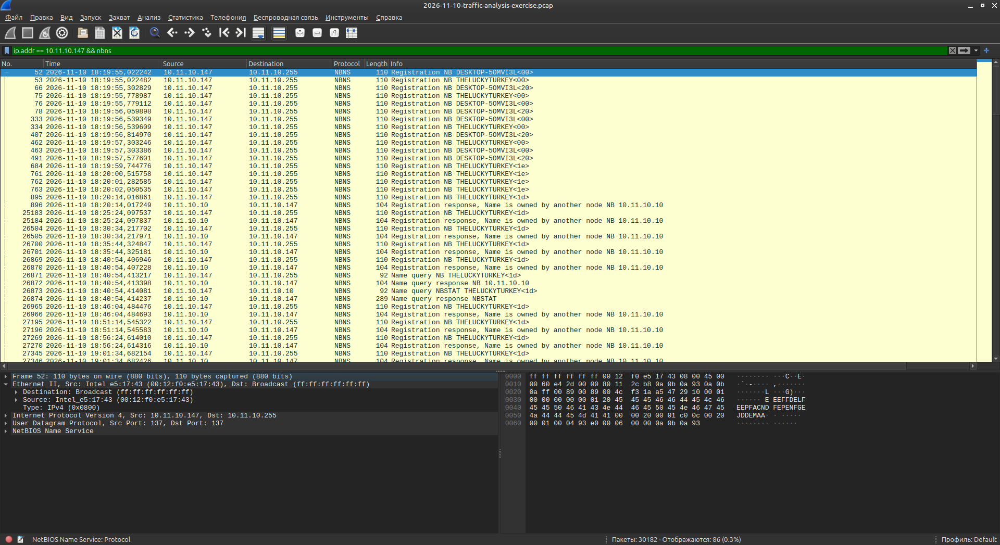
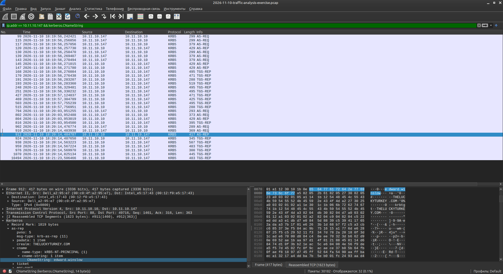
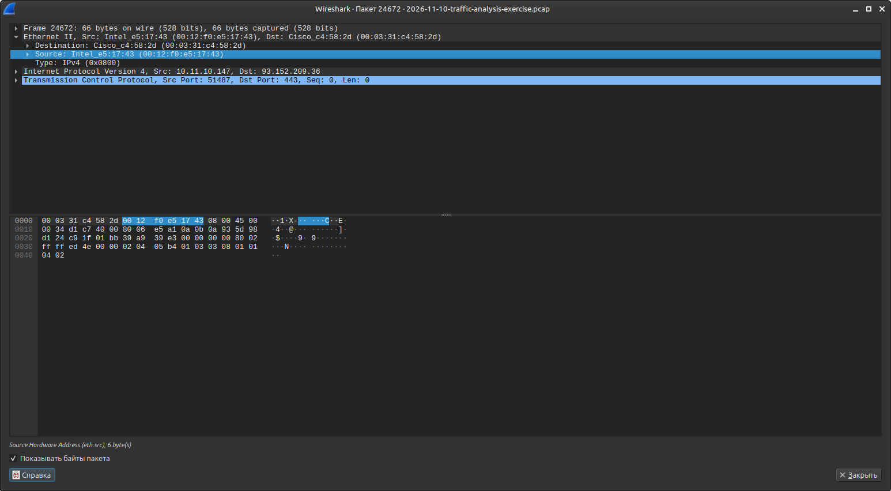

# Traffic Analysis Exercise: The Lucky Turkey (2026-11-10)

**Source:** [malware-traffic-analysis.net](https://www.malware-traffic-analysis.net/2026/11/10/index.html)  
**Date completed:** 14 November 2026  
**Tool:** Wireshark  
**Malware:** NetSupport RAT

---

## Description

SOC alert for **NetSupport RAT** traffic to `93.152.209.36:443`.  
The task is to analyze the provided pcap and answer the incident report questions.

### Environment

| Item | Value |
|------|-------|
| LAN segment | `10.11.10.0/24` |
| Domain | `theluckyturkey.com` |
| AD name | `THELUCKYTURKEY` |
| Domain Controller | `10.11.10.10` (LUCKYTURKEY-DC) |
| Gateway | `10.11.10.1` |

---

## Screenshots

### Traffic overview


### Infected client IP + start of RAT traffic


### Host name (NBNS)


### User account (Kerberos)


### MAC address


---

## Answers

| Question | Answer |
|----------|--------|
| What is the date and start time of the NetSupport RAT traffic? | **2026-11-10 18:22:07** |
| What is the IP address of the infected Windows client? | **10.11.10.147** |
| What is the MAC address of the infected Windows client? | **00:12:f0:e5:17:43** |
| What is the host name of the infected Windows client? | **DESKTOP-50MVI3L** |
| What is the user account name from the infected Windows client? | **edward.winslow** |

---

## Evidence

### 1. Start of NetSupport RAT traffic

- **Packet:** `24672`
- **Time:** `2026-11-10 18:22:07.559531`
- **Details:** TCP SYN from `10.11.10.147:51487` → `93.152.209.36:443`
- **Filter used:** `ip.addr == 93.152.209.36`

Subsequent packets show HTTP POST requests to `/fakeurl.htm` (e.g. packets `24675`, `24678`, `24682`, etc.).

### 2. Infected client IP address

- **Source IP** in the first SYN packet and all subsequent C2 traffic: **10.11.10.147**
- Confirmed across multiple protocols (TCP, HTTP, Kerberos, NBNS)

### 3. Host name

- **Packet:** `52`
- **Protocol:** NBNS
- **Details:** Registration NB **DESKTOP-50MVI3L**<00>
- **Filter used:** `ip.addr == 10.11.10.147 && nbns`

Additional NBNS registrations for the same hostname appear throughout the capture (e.g. packets `53`, `66`, `75`, etc.).

### 4. User account name

- **Packet:** `912`
- **Protocol:** Kerberos (AS-REP)
- **Details:** `CNameString: edward.winslow`
- **Filter used:** `ip.addr == 10.11.10.147 && kerberos.CNameString`

The account is also visible in other Kerberos exchanges between the client and the domain controller (`10.11.10.10`).

### 5. MAC address

- **Source:** Ethernet header of packets originating from `10.11.10.147`
- **Value:** `00:12:f0:e5:17:43` (Intel)
- Visible in the first SYN packet to the C2 (`24672`) and in NBNS frames

---

## Useful Wireshark Filters

```
ip.addr == 10.11.10.147
ip.addr == 93.152.209.36
ip.addr == 10.11.10.147 && nbns
ip.addr == 10.11.10.147 && kerberos.CNameString
http.host contains "93.152.209.36"
tcp.flags.syn == 1 && tcp.flags.ack == 0 && ip.dst == 93.152.209.36
```

---

## Conclusion

**What happened?**  
A Windows host on the internal network initiated a connection to an external IP (`93.152.209.36:443`) consistent with NetSupport RAT C2 traffic. The first TCP SYN occurred at 18:22:07, followed by repeated HTTP POST requests to `/fakeurl.htm`.

**Which host was affected?**  
- IP: `10.11.10.147`  
- Hostname: `DESKTOP-50MVI3L`  
- MAC: `00:12:f0:e5:17:43`  
- Logged-in user: `edward.winslow`

**What evidence supports the identification?**  
- Packet 24672 shows the initial TCP SYN to the C2.  
- Packet 52 (and subsequent NBNS frames) reveal the hostname.  
- Packet 912 contains the Kerberos principal `edward.winslow`.  
- Ethernet source address in the same frames confirms the MAC address.

**What should a SOC analyst investigate next?**  
- Check the infected host for running processes, persistence mechanisms, and any additional outbound connections.  
- Review other hosts for signs of lateral movement from `10.11.10.147`.  
- Examine authentication logs for the account `edward.winslow`.  
- Block the C2 IP (`93.152.209.36`) and hunt for related indicators across the network.

---
