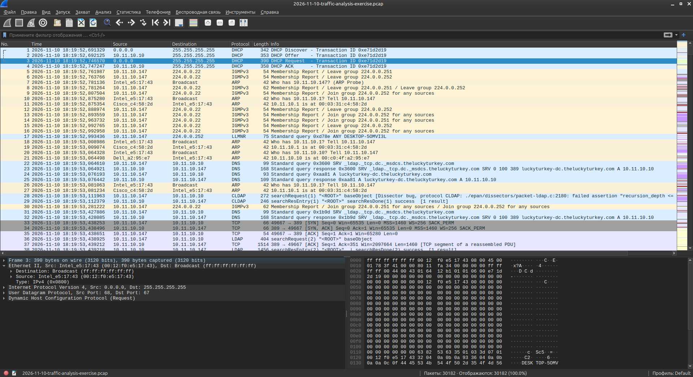
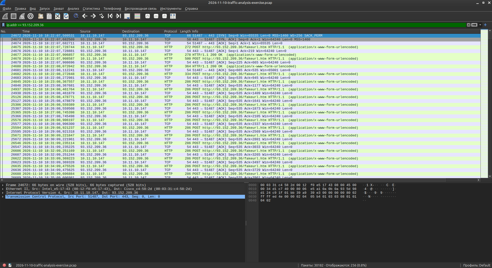
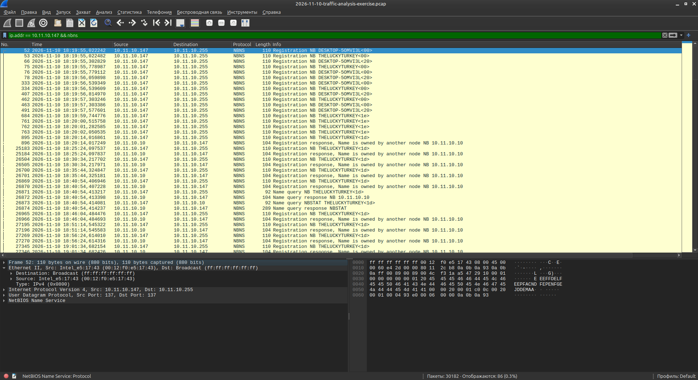
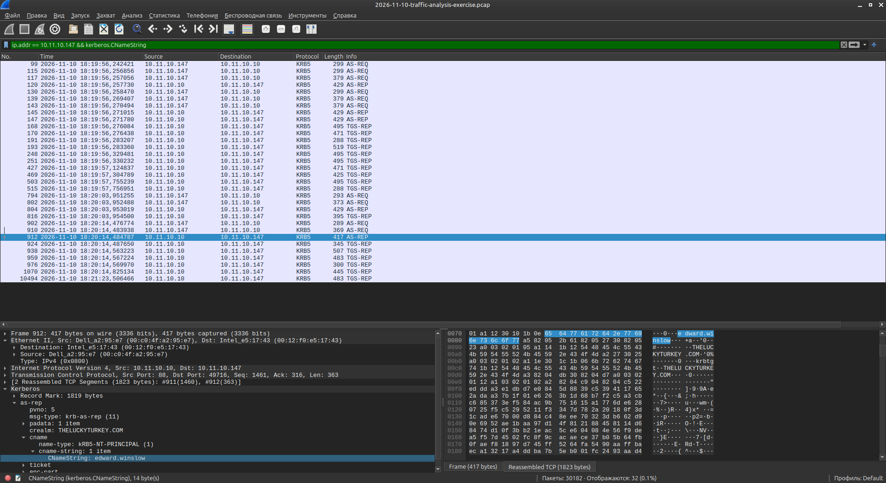
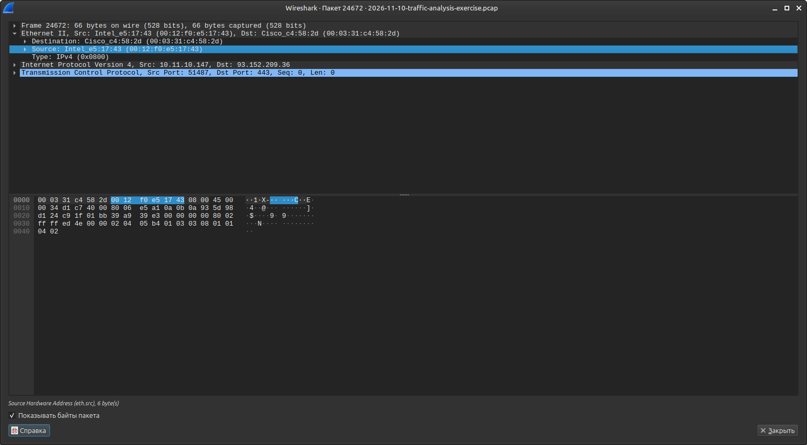

# Traffic Analysis Exercise: The Lucky Turkey (2026-11-10)

**Source:** [malware-traffic-analysis.net](https://www.malware-traffic-analysis.net/2026/11/10/index.html)  
**Date completed:** 14 November 2026  
**Tool:** Wireshark  
**Malware:** NetSupport RAT

---

## Description

SOC alert for **NetSupport RAT** traffic to `93.152.209.36:443`.  
The task is to analyze the provided pcap and answer the incident report questions.

### Environment

| Item | Value |
|------|-------|
| LAN segment | `10.11.10.0/24` |
| Domain | `theluckyturkey.com` |
| AD name | `THELUCKYTURKEY` |
| Domain Controller | `10.11.10.10` (LUCKYTURKEY-DC) |
| Gateway | `10.11.10.1` |

---

## Screenshots

### Traffic overview


### Infected client IP + start of RAT traffic


### Host name (NBNS)


### User account (Kerberos)


### MAC address


---

## Answers

| Question | Answer |
|----------|--------|
| What is the date and start time of the NetSupport RAT traffic? | **2026-11-10 18:22:07** |
| What is the IP address of the infected Windows client? | **10.11.10.147** |
| What is the MAC address of the infected Windows client? | **00:12:f0:e5:17:43** |
| What is the host name of the infected Windows client? | **DESKTOP-50MVI3L** |
| What is the user account name from the infected Windows client? | **edward.winslow** |

---

## Analysis Notes

### 1. Infected Client IP
Filter: `ip.addr == 10.11.10.147`  
Client communicates heavily with the Domain Controller (`10.11.10.10`) and later with the C2.

### 2. Start of NetSupport RAT traffic
Filter: `ip.addr == 93.152.209.36`  
First TCP SYN to `93.152.209.36:443` at **18:22:07**.  
Followed by HTTP POST requests to `/fakeurl.htm`.

### 3. Host name
Filter: `ip.addr == 10.11.10.147 && nbns`  
NBNS Registration shows: **DESKTOP-50MVI3L**

### 4. User account
Filter: `ip.addr == 10.11.10.147 && kerberos.CNameString`  
Kerberos AS-REP contains: **edward.winslow**

### 5. MAC address
In any Ethernet frame from `10.11.10.147`:  
**00:12:f0:e5:17:43** (Intel)

---

## Useful Wireshark Filters

```
ip.addr == 10.11.10.147
ip.addr == 93.152.209.36
ip.addr == 10.11.10.147 && nbns
ip.addr == 10.11.10.147 && kerberos.CNameString
http.host contains "93.152.209.36"
```

---

## Key Takeaways

- NetSupport RAT C2 traffic went to `93.152.209.36:443`
- Infected host was part of the Active Directory domain `theluckyturkey.com`
- User `edward.winslow` was logged in on the infected machine
- Combination of NBNS + Kerberos + Ethernet headers quickly gives full host identification

---
