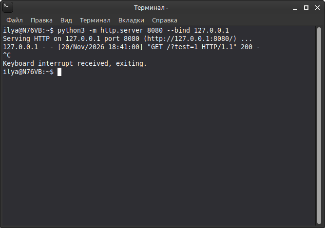
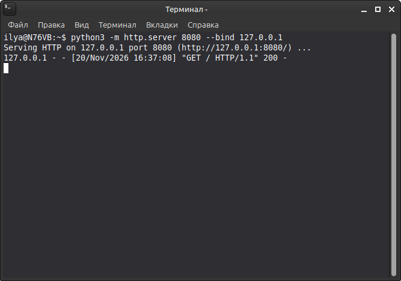
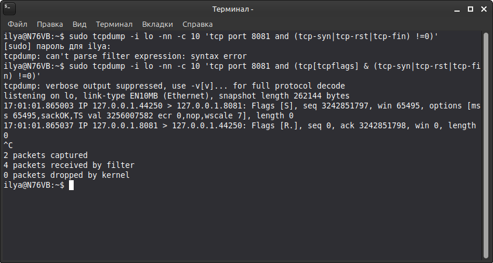

# Перехват и анализ трафика: `tcpdump` и Wireshark

Практический конспект по использованию `tcpdump` в задачах веб-безопасности и сетевой диагностики: быстрый захват пакетов на локальном интерфейсе (`lo`) и сетевых адаптерах, фильтрация BPF-выражениями, чтение TCP-флагов и связка с Wireshark.

> **Примечание по безопасности:** все эксперименты выполнены на локальном loopback-интерфейсе (`127.0.0.1`) и зарезервированных адресах для документации (`192.0.2.0/24` по RFC 5737). Не загружайте в репозиторий `.pcap`-дампы и скриншоты с реальными паролями, сессионными токенами или ключами API.

---

## Содержание

1. [Базовые ключи и запуск](#базовые-ключи-и-запуск)
2. [BPF-фильтры](#bpf-фильтры)
3. [Кейс 1. Перехват открытого HTTP-трафика (`-A`)](#кейс-1-перехват-открытого-http-трафика--a)
4. [Кейс 2. Жизненный цикл TCP-соединения (`SYN`, `SYN-ACK`, `FIN`)](#кейс-2-жизненный-цикл-tcp-соединения-syn-syn-ack-fin)
5. [Кейс 3. Обращение к закрытому порту (`RST`)](#кейс-3-обращение-к-закрытому-порту-rst)
6. [Кейс 4. Таймаут и ретрансмиты `SYN`](#кейс-4-таймаут-и-ретрансмиты-syn)
7. [Кейс 5. Мониторинг DNS-запросов (`port 53`)](#кейс-5-мониторинг-dns-запросов-port-53)
8. [Связка `tcpdump` + Wireshark](#связка-tcpdump--wireshark)

---

## Базовые ключи и запуск

| Флаг / Команда | Назначение | Пример |
|---|---|---|
| `-D` | Список доступных интерфейсов | `sudo tcpdump -D` |
| `-i <iface>` | Выбор интерфейса (`lo`, `eth0`, `enp4s0`, `any`) | `sudo tcpdump -i lo` |
| `-nn` | Отключить резолвинг IP-адресов и номеров портов в имена | `sudo tcpdump -i lo -nn` |
| `-c <N>` | Завершить захват после `N` пакетов | `sudo tcpdump -i lo -nn -c 20` |
| `-A` / `-X` | Вывод полезной нагрузки в ASCII (`-A`) или HEX + ASCII (`-X`) | `sudo tcpdump -i lo -nn -A 'tcp port 8080'` |
| `-w <file.pcap>` | Сохранить перехваченные пакеты в `.pcap` | `sudo tcpdump -i lo -nn -w capture.pcap` |
| `-r <file.pcap>` | Прочитать сохранённый дамп с фильтрацией | `sudo tcpdump -nn -r capture.pcap 'tcp port 8080'` |

---

## BPF-фильтры

```bash
# Трафик конкретного хоста (источник или назначение)
sudo tcpdump -i any -nn host 192.0.2.20

# Только исходящий или входящий трафик
sudo tcpdump -i any -nn src 127.0.0.1
sudo tcpdump -i any -nn dst 192.0.2.20

# Фильтрация по портам и протоколам
sudo tcpdump -i any -nn 'tcp port 80 or tcp port 443'
sudo tcpdump -i any -nn 'udp port 53 or tcp port 53'

# Фильтрация только управляющих TCP-флагов (SYN, RST, FIN)
sudo tcpdump -i lo -nn 'tcp port 8080 and (tcp[tcpflags] & (tcp-syn|tcp-rst|tcp-fin) != 0)'
```

---

## Кейс 1. Перехват открытого HTTP-трафика (`-A`)

**Цель:** увидеть в открытом виде этапы установки TCP-сессии, HTTP-запрос (`GET`), заголовки и HTML-ответ сервера.

**Воспроизведение на локальном стенде:**
1. Запуск тестового HTTP-сервера на `127.0.0.1:8080`:
   ```bash
   python3 -m http.server 8080 --bind 127.0.0.1
   ```
2. Запуск перехвата с выводом содержимого в ASCII:
   ```bash
   sudo tcpdump -i lo -nn -c 20 -A 'tcp port 8080'
   ```
3. Отправка запроса:
   ```bash
   curl -s -i "http://127.0.0.1:8080/?test=1" | head -n 5
   ```

**Результат захвата:**




**На что обратить внимание:**
* Первые три пакета (`Flags [S]`, `Flags [S.]`, `Flags [.]`) — классическое трёхэтапное TCP-рукопожатие.
* Пакет с `Flags [P.]` передаёт полезную нагрузку: в открытом виде видны строка запроса `GET /?test=1 HTTP/1.1`, `Host: 127.0.0.1:8080` и `User-Agent: curl/8.5.0`.
* Ответ сервера содержит статус `HTTP/1.0 200 OK`, заголовки и тело HTML-страницы. Поверх HTTPS (`TLS`) эти данные были бы зашифрованы.

---

## Кейс 2. Жизненный цикл TCP-соединения (`SYN`, `SYN-ACK`, `FIN`)

**Цель:** отфильтровать прикладные данные и проследить только открытие и корректное закрытие TCP-сессии.

**Команда:**
```bash
sudo tcpdump -i lo -nn -c 16 'tcp port 8080 and (tcp[tcpflags] & (tcp-syn|tcp-rst|tcp-fin) != 0)'
```

**Результат захвата:**




**На что обратить внимание:**
* `Flags [S]` (`127.0.0.1.42828 > 127.0.0.1.8080`) — клиент инициирует соединение.
* `Flags [S.]` (`127.0.0.1.8080 > 127.0.0.1.42828`) — порт открыт, сервер подтверждает `SYN` и отправляет свой `SYN`.
* Два пакета `Flags [F.]` в конце — корректное двустороннее закрытие соединения (`FIN-ACK`) после передачи ответа.

---

## Кейс 3. Обращение к закрытому порту (`RST`)

**Цель:** определить поведение хоста, когда порт доступен по сети, но на нём не запущена ни одна служба.

**Команда:**
```bash
# Терминал 1: захват управляющих флагов на закрытом порту 8081
sudo tcpdump -i lo -nn -c 10 'tcp port 8081 and (tcp[tcpflags] & (tcp-syn|tcp-rst|tcp-fin) != 0)'

# Терминал 2: попытка подключения
curl -m 2 -s http://127.0.0.1:8081 || true
```

**Результат захвата:**



**На что обратить внимание:**
* После отправки `Flags [S]` на `127.0.0.1.8081` ядро системы мгновенно возвращает `Flags [R.]` (`RST, ACK`).
* Наличие `RST` позволяет сразу отличить закрытый порт от случая, когда пакеты молча отбрасываются фаерволом.

---

## Кейс 4. Таймаут и ретрансмиты `SYN`

**Цель:** увидеть, как выглядит сетевой трафик при недоступности целевого хоста или фильтрации (`DROP`) на фаерволе.

**Команда:**
```bash
# Терминал 1: отслеживание SYN-пакетов к адресу документации 192.0.2.20
sudo tcpdump -i any -nn -c 8 'host 192.0.2.20 and tcp port 8080 and (tcp[tcpflags] & tcp-syn != 0)'

# Терминал 2: попытка подключения с ограничением времени
curl -m 4 -s http://192.0.2.20:8080 || true
```

**Результат захвата:**


**На что обратить внимание:**
* Клиент отправляет `Flags [S]` с `seq 2776643017` и, не получив ни `SYN-ACK`, ни `RST`, повторяет отправку пакета с тем же `seq` примерно раз в секунду (`16:05:58`, `16:05:59`, `16:06:00`, `16:06:01`).

---

## Кейс 5. Мониторинг DNS-запросов (`port 53`)

**Цель:** проверить, какие доменные имена резолвит система и через какой DNS-сервер идут запросы.

**Команда:**
```bash
sudo tcpdump -i any -nn -c 10 'udp port 53 or tcp port 53'
```

**Результат захвата:**


**На что обратить внимание:**
* Запросы идут на локальный stub-резолвер `127.0.0.53:53`.
* В выводе видны типы запрашиваемых записей: `A?` (IPv4-адрес, например `example.com.`) и `AAAA?` (IPv6-адрес).

---

## Связка `tcpdump` + Wireshark

Когда на удалённом сервере или ВМ нет графического интерфейса, удобнее записать узкий дамп через `tcpdump`, а детальный разбор (реконструкцию TCP-потоков, анализ HTTP/TLS и таймингов) выполнить в Wireshark:

```bash
# 1. Записать дамп на целевой машине
sudo tcpdump -i lo -nn -w local_http.pcap 'tcp port 8080'

# 2. Открыть файл в Wireshark
wireshark local_http.pcap
```
