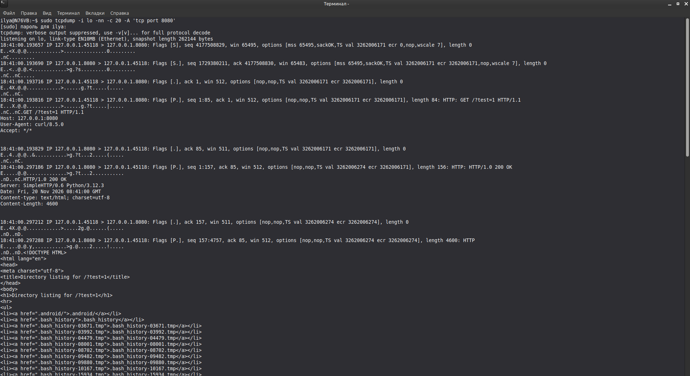
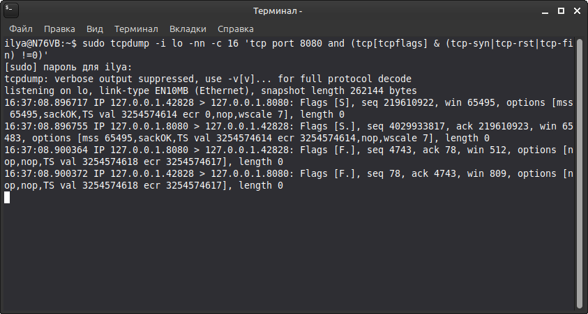
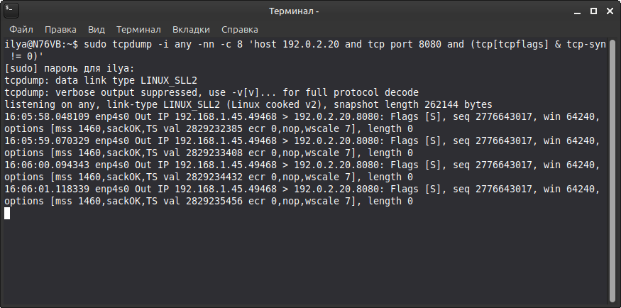
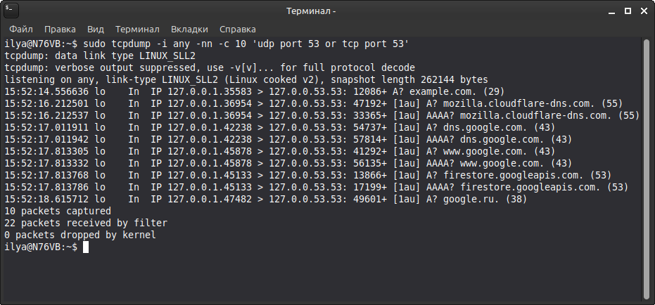

# Packet Capture & Traffic Analysis: `tcpdump` and Wireshark

Practical lab notes on using `tcpdump` for web security and network diagnostics: capturing packets on local loopback (`lo`) and network interfaces, filtering with BPF expressions, reading TCP flags, and integrating with Wireshark.

> **Security Note:** All experiments were performed on the local loopback interface (`127.0.0.1`) and documentation-reserved IP blocks (`192.0.2.0/24` per RFC 5737). Never commit `.pcap` captures or screenshots containing real credentials, session tokens, or API keys to a public repository.

## Table of Contents

1. [Basic Flags & Usage](#basic-flags--usage)
2. [BPF Filters](#bpf-filters)
3. [Case 1. Capturing Cleartext HTTP Traffic (`-A`)](#case-1-capturing-cleartext-http-traffic--a)
4. [Case 2. TCP Connection Lifecycle (`SYN`, `SYN-ACK`, `FIN`)](#case-2-tcp-connection-lifecycle-syn-syn-ack-fin)
5. [Case 3. Probing a Closed Port (`RST`)](#case-3-probing-a-closed-port-rst)
6. [Case 4. Connection Timeout & `SYN` Retransmissions](#case-4-connection-timeout--syn-retransmissions)
7. [Case 5. Monitoring DNS Queries (`port 53`)](#case-5-monitoring-dns-queries-port-53)
8. [Workflow: `tcpdump` + Wireshark](#workflow-tcpdump--wireshark)

## Basic Flags & Usage

| Flag / Command | Description | Example |
| :--- | :--- | :--- |
| `-D` | List available network interfaces | `sudo tcpdump -D` |
| `-i <iface>` | Specify capture interface (`lo`, `eth0`, `enp4s0`, `any`) | `sudo tcpdump -i lo` |
| `-nn` | Disable DNS host and port name resolution | `sudo tcpdump -i lo -nn` |
| `-c <N>` | Stop capturing after `N` packets | `sudo tcpdump -i lo -nn -c 20` |
| `-A` / `-X` | Print packet payload in ASCII (`-A`) or HEX + ASCII (`-X`) | `sudo tcpdump -i lo -nn -A 'tcp port 8080'` |
| `-w <file.pcap>` | Write raw packets to a `.pcap` file | `sudo tcpdump -i lo -nn -w capture.pcap` |
| `-r <file.pcap>` | Read and filter packets from a saved `.pcap` file | `sudo tcpdump -nn -r capture.pcap 'tcp port 8080'` |

## BPF Filters

```bash
# Traffic involving a specific host (source or destination)
sudo tcpdump -i any -nn host 192.0.2.20

# Only outgoing or incoming traffic
sudo tcpdump -i any -nn src 127.0.0.1
sudo tcpdump -i any -nn dst 192.0.2.20

# Filter by specific ports and protocols
sudo tcpdump -i any -nn 'tcp port 80 or tcp port 443'
sudo tcpdump -i any -nn 'udp port 53 or tcp port 53'

# Filter only TCP control flags (SYN, RST, FIN)
sudo tcpdump -i lo -nn 'tcp port 8080 and (tcp[tcpflags] & (tcp-syn|tcp-rst|tcp-fin) != 0)'
```

## Case 1. Capturing Cleartext HTTP Traffic (`-A`)

**Goal:** Observe the TCP three-way handshake, cleartext HTTP request (`GET`), headers, and HTML response payload.

**Local Lab Setup:**

1. Start a local test HTTP server on `127.0.0.1:8080`:
   ```bash
   python3 -m http.server 8080 --bind 127.0.0.1
   ```

2. Start packet capture with ASCII payload output:
   ```bash
   sudo tcpdump -i lo -nn -c 20 -A 'tcp port 8080'
   ```

3. Send an HTTP request:
   ```bash
   curl -s -i "http://127.0.0.1:8080/?test=1" | head -n 5
   ```

**Capture Results:**




**Key Takeaways:**

* The first three packets (`Flags [S]`, `Flags [S.]`, `Flags [.]`) represent the standard TCP three-way handshake.
* The packet with `Flags [P.]` carries application data: `GET /?test=1 HTTP/1.1`, `Host: 127.0.0.1:8080`, and `User-Agent: curl/8.5.0` are all readable in plaintext.
* The server response returns `HTTP/1.0 200 OK`, response headers, and the HTML body. Over HTTPS (`TLS`), this payload would be encrypted.

## Case 2. TCP Connection Lifecycle (`SYN`, `SYN-ACK`, `FIN`)

**Goal:** Strip out application data and inspect only the opening and graceful teardown of a TCP session.

**Command:**

```bash
sudo tcpdump -i lo -nn -c 16 'tcp port 8080 and (tcp[tcpflags] & (tcp-syn|tcp-rst|tcp-fin) != 0)'
```

**Capture Results:**




**Key Takeaways:**

* `Flags [S]` (`127.0.0.1.42828 > 127.0.0.1.8080`) — the client initiates the connection.
* `Flags [S.]` (`127.0.0.1.8080 > 127.0.0.1.42828`) — the port is open; the server acknowledges the client's `SYN` and sends its own `SYN`.
* Two `Flags [F.]` packets at the end — bidirectional graceful connection termination (`FIN-ACK`) after the HTTP response is delivered.

## Case 3. Probing a Closed Port (`RST`)

**Goal:** Identify host behavior when a target is reachable over the network, but no service is listening on the destination port.

**Commands:**

```bash
# Terminal 1: Capture TCP control flags on closed port 8081
sudo tcpdump -i lo -nn -c 10 'tcp port 8081 and (tcp[tcpflags] & (tcp-syn|tcp-rst|tcp-fin) != 0)'

# Terminal 2: Attempt connection
curl -m 2 -s http://127.0.0.1:8081 || true
```

**Capture Results:**


**Key Takeaways:**

* Immediately after receiving `Flags [S]` on `127.0.0.1.8081`, the OS kernel replies with `Flags [R.]` (`RST, ACK`).
* Seeing an immediate `RST` distinguishes a closed port from a port silently dropped by a firewall.

## Case 4. Connection Timeout & `SYN` Retransmissions

**Goal:** Observe network behavior when a destination host is unreachable or packets are silently dropped (`DROP`) by a firewall.

**Commands:**

```bash
# Terminal 1: Monitor SYN packets sent to documentation IP 192.0.2.20
sudo tcpdump -i any -nn -c 8 'host 192.0.2.20 and tcp port 8080 and (tcp[tcpflags] & tcp-syn != 0)'

# Terminal 2: Attempt connection with a 4-second timeout
curl -m 4 -s http://192.0.2.20:8080 || true
```

**Capture Results:**



**Key Takeaways:**

* The client sends `Flags [S]` with `seq 2776643017` and, receiving neither `SYN-ACK` nor `RST`, retransmits the exact same `SYN` packet (`seq 2776643017`) roughly once per second (`16:05:58`, `16:05:59`, `16:06:00`, `16:06:01`).

## Case 5. Monitoring DNS Queries (`port 53`)

**Goal:** Inspect which domain names the system resolves and which DNS resolver handles the queries.

**Command:**

```bash
sudo tcpdump -i any -nn -c 10 'udp port 53 or tcp port 53'
```

**Capture Results:**



**Key Takeaways:**

* Queries are routed to the local stub resolver at `127.0.0.53:53`.
* The output clearly displays record types being queried: `A?` (IPv4 address, e.g., `example.com.`) and `AAAA?` (IPv6 address).

## Workflow: `tcpdump` + Wireshark

When working on a headless server or VM without a GUI, capture a targeted `.pcap` dump with `tcpdump` and transfer it locally for deeper inspection in Wireshark (TCP stream reassembly, HTTP/TLS dissection, and timing analysis):

```bash
# 1. Capture targeted traffic to a file on the remote/target host
sudo tcpdump -i lo -nn -w local_http.pcap 'tcp port 8080'

# 2. Open the capture file in Wireshark
wireshark local_http.pcap
```
